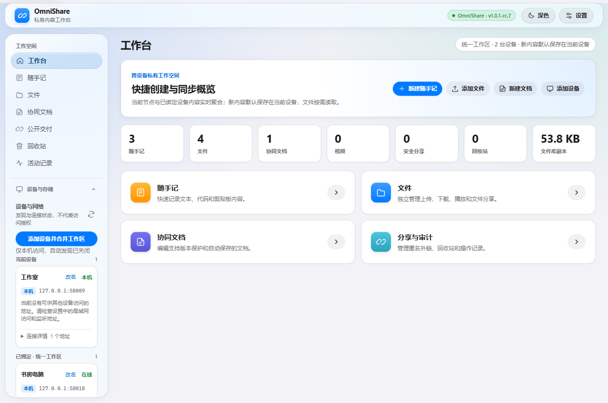
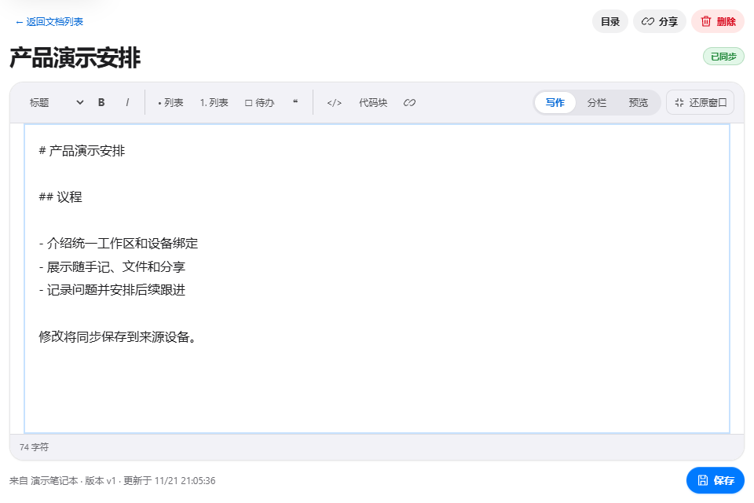

<p align="center"></p>

# OmniShare

OmniShare 是一个自托管的跨设备工作区。设备绑定后，可以在同一个界面查看和管理各设备上的随手记、文件和协同文档。内容保存在所属设备，文件按需读取。

## 工作区功能

- **随手记**支持目录、标签、置顶和 Markdown 写作、分栏与预览。
- **文件**支持批量接收、从本机添加快捷方式、按需下载和视频播放。可将文件转移到当前设备，收到并校验后清理来源条目。
- **协同文档**提供同一套 Markdown 编辑器，支持自动保存、版本冲突提示和草稿保留。
- **公开交付**可将随手记、协同文档或文件发送给未绑定设备的收件人。安装并配置可选的独立 HTTPS 领取服务后，即可创建有有效期、可选口令和可撤销的链接。
- **本机数据**保存在每台设备选择的工作区文件夹中，随手记和协同文档以 Markdown 文件保存，并可引用其他已绑定设备的文件。工作区支持回收站和备份。

## 界面预览

截图使用 Windows 11 上运行的独立演示工作区。画面中的设备地址已遮挡。



工作台显示已绑定设备以及统一工作区的内容概况。


随手记按目录筛选，并标明每条内容的来源设备。



候选版在小窗口中优先显示正文，目录和格式工具按需展开。协同文档在当前界面保存到内容所属设备。

## 下载

v1.0.1-rc.6 修复了两台设备时钟略有偏差时可发现却无法绑定的问题，改进了慢速文件转移和大目录刷新，并支持中文口令备份与恢复。Mac 的系统选框、访达拖入和路径粘贴已在 Intel 与 Apple Silicon 上使用同一份通用安装包验证。此候选版采用临时签名，尚未经过 Apple 公证。[下载 macOS 安装包](https://github.com/Azurefly/omnishare/releases/download/v1.0.1-rc.6/OmniShare-v1.0.1-rc.6-macos-universal.dmg)

Windows 可选 EXE 或 MSI，Linux 可选 DEB 或 AppImage。各平台安装包和 `SHA256SUMS.txt` 校验文件都在发布页的 **Assets** 中。[下载 Windows EXE](https://github.com/Azurefly/omnishare/releases/download/v1.0.1-rc.6/OmniShare-v1.0.1-rc.6-windows-x64-setup.exe) · [v1.0.1-rc.6 候选版](https://github.com/Azurefly/omnishare/releases/tag/v1.0.1-rc.6) · [全部版本](https://github.com/Azurefly/omnishare/releases)

## 从源码运行

[v1.0.0 源码发布](https://github.com/Azurefly/omnishare/releases/tag/v1.0.0) 提供 GitHub 生成的源码归档。Windows、Linux 和 macOS 桌面端可以按[桌面构建说明](desktop/README.md)自行构建。

安装 Go 1.26.5 和 Node.js 22 后，在 Windows PowerShell 中打开项目根目录，执行：

```powershell
npm --prefix frontend run build
Set-Location backend
go run ./cmd/omnishare --listen localhost --port 8081 --data-dir ..\data --no-browser
```

打开[本机工作台](http://localhost:8081)。需要跨设备使用时，在可信局域网或 Tailscale 上配置可访问地址，再从工作台添加设备。访问密钥按设备配置。

## 公开交付服务

[独立领取站的源码与部署说明](delivery-server/README.md)位于 delivery-server 目录。领取站提供 HTTPS 领取页和附件下载。发布、查看交付记录和撤销使用同一 HTTPS 地址下的认证接口。在每台设备的「公开交付 → 配置交付服务器」填写管理员提供的连接信息。[查看 HTTPS 直连配置步骤](delivery-server/README.md#在-omnishare-中配置)。

## 项目文档

- [开发与贡献](CONTRIBUTING.md)
- [系统架构](docs/ARCHITECTURE.md)
- [工作区旧版分享与备份](docs/SECURE_SHARING.md)
- [Mac 安装、设备绑定与诊断](docs/MACOS.md)
- [v1.0.1-rc.6 变更说明](docs/RELEASE_NOTES_v1.0.1-rc.6.md)
- [v1.0.1-rc.2 变更说明](docs/RELEASE_NOTES_v1.0.1-rc.2.md)
- [安全说明](SECURITY.md)
- [v1.0.1-rc.1 发布说明](docs/RELEASE_NOTES_v1.0.1-rc.1.md)
- [v1.0.0 发布说明](docs/RELEASE_NOTES_v1.0.0.md)
