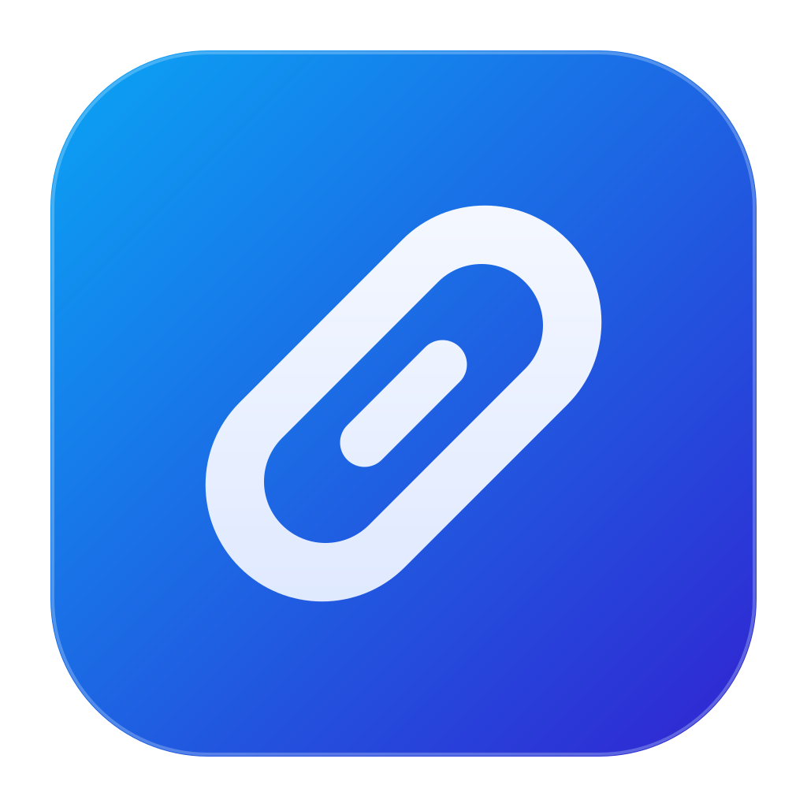
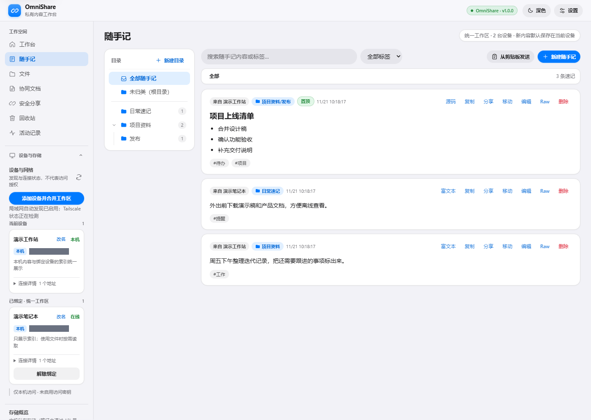

<p align="center"></p>

# OmniShare

OmniShare 是一个自托管的跨设备工作区。设备绑定后，可以在同一个界面查看和管理各设备上的随手记、文件和协同文档。内容保存在所属设备，文件按需读取。

## 工作区功能

- **随手记**支持目录、标签、置顶和 Markdown 写作、分栏与预览。
- **文件**支持批量上传、保留目录结构、按需下载和视频播放。
- **协同文档**提供同一套 Markdown 编辑器，支持自动保存、版本冲突提示和草稿保留。
- **安全分享**支持有效期、访问次数和随时撤销。分享链接生成后可直接复制。
- **本机数据**可通过回收站恢复，支持导出备份及使用口令加密备份。

## 界面预览

截图使用 Windows 11 上运行的独立演示工作区。画面中的设备地址已遮挡。


工作台显示已绑定设备以及统一工作区的内容概况。



随手记按目录筛选，并标明每条内容的来源设备。


候选版在小窗口中优先显示正文，目录和格式工具按需展开。协同文档在当前界面保存到内容所属设备。

## 下载

[候选版 v1.0.1-rc.1](https://github.com/Azurefly/omnishare/releases/tag/v1.0.1-rc.1) 提供 Markdown 编辑器改进，适合试用。

## 从源码运行

[v1.0.0 源码发布](https://github.com/Azurefly/omnishare/releases/tag/v1.0.0) 提供 GitHub 生成的源码归档。Windows、Linux 和 macOS 桌面端可以按[桌面构建说明](desktop/README.md)自行构建。

安装 Go 1.26.5 和 Node.js 22 后，在 Windows PowerShell 中打开项目根目录，执行：

```powershell
npm --prefix frontend run build
Set-Location backend
go run ./cmd/omnishare --listen localhost --port 8081 --data-dir ..\data --no-browser
```

打开[本机工作台](http://localhost:8081)。需要跨设备使用时，在可信局域网或 Tailscale 上配置可访问地址，再从工作台添加设备。访问密钥按设备配置。

## 项目文档

- [开发与贡献](CONTRIBUTING.md)
- [系统架构](docs/ARCHITECTURE.md)
- [安全分享](docs/SECURE_SHARING.md)
- [安全说明](SECURITY.md)
- [v1.0.1-rc.1 发布说明](docs/RELEASE_NOTES_v1.0.1-rc.1.md)
- [v1.0.0 发布说明](docs/RELEASE_NOTES_v1.0.0.md)
